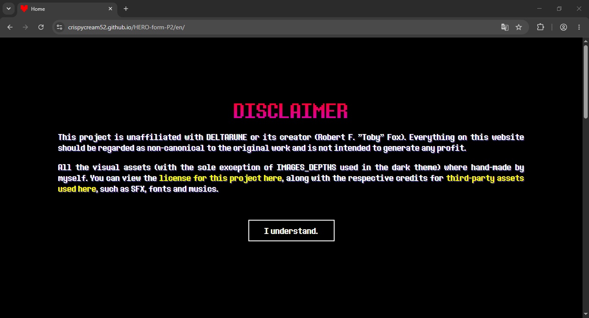
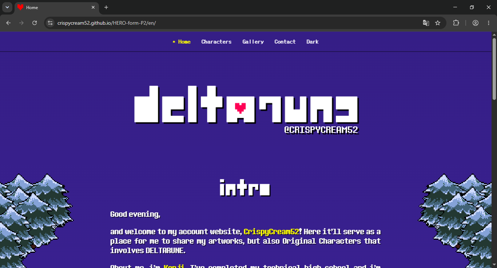
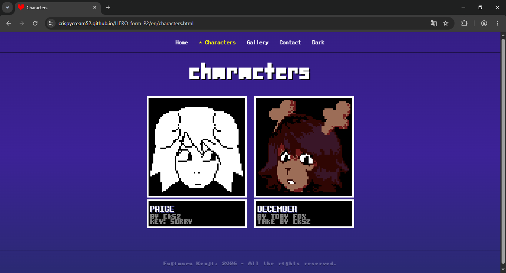
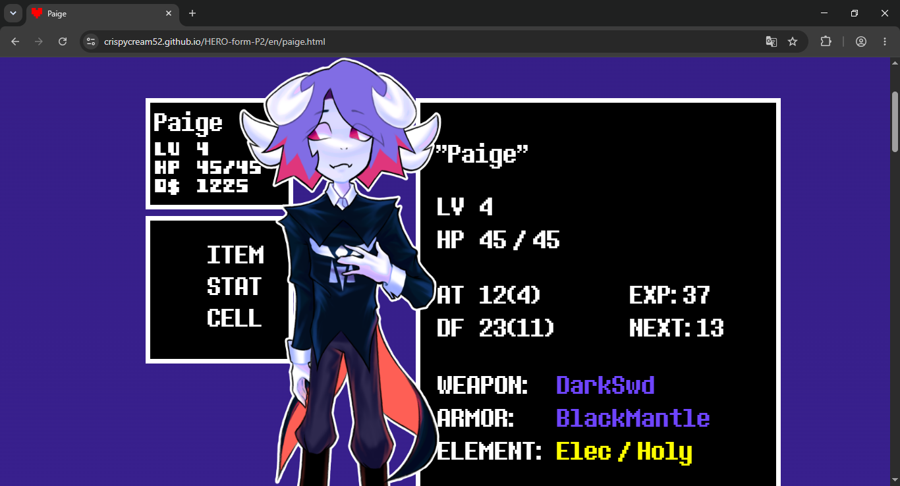
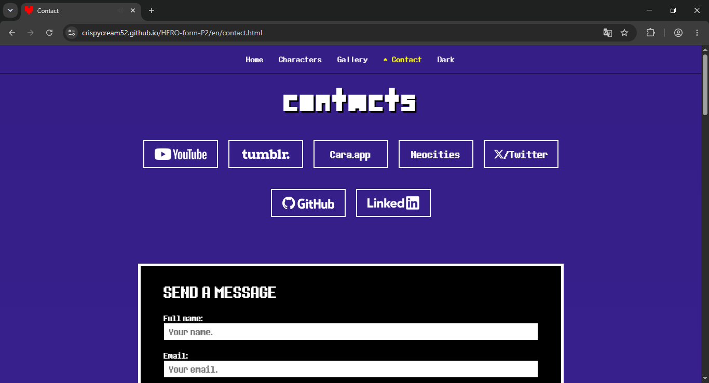

# HERO-form-P2
## ABOUT THE PROJECT
Purpose: academic &amp; personal project intended to apply the programming fundamentals learnt in **Web Technology** class.

### ⓘ NOTE
Non-official project based on DELTARUNE. This work is not related to Toby Fox nor the DELTARUNE team.

This is the full project itself, with everything that I've planned so far + the academic requirements. This work will <ins>**not**</ins> be displayed as an <ins>**open source**</ins> and is not for <ins>**public use**</ins>, thus no one have the permission to make use of my work in any shape or form.

### WHAT'S THE DIFFERENCE BETWEEN 'HERO-form-P2' AND 'MANTLE-original'?
Whilst HERO-form-P2 meets all the requirements of the project, many of its features are not to my liking, precisely because they deviate from the original premise or do not enhance QoL, nor the user experience. Therefore, MANTLE-original is the original project, containing only the features I had originally planned.

## FEATURES
 - Intro, characters, gallery, contact and credits pages;
 - full CSS responsiveness (mobile and desktop);
   - Sandwich menu;
   - Gallery carousel;
   - Character menu adaptation;
 - English (en) and Portuguese (pt-BR) support;
 - DELTARUNE's faithful visual identity;
 - Gestalt and the Seven UI principles;
 - Secret pages, hidden informations and a game to be found.

## TOOLS
 - HTML5
 - CSS3
 - JavaScript
 - Figma
 - GitHub
 - Itch.io
 - Kristal Engine v0.10.0

#### ABOUT THE PROTOTYPE
In order to access the Figma prototype, you must upload the 'mantle.site' file inside Figma itself.
1. Access https://www.figma.com
2. Click on the 'more' dropdown option located on the navbar and then 'import'

#### ACCESS THE WEBSITE
1. via .zip
> Extract the package and open the 'index.html' file in a browser.
2. via Github
> Access the domain https://crispycream52.github.io/HERO-form-P2/

## SCREENSHOTS

## UX / UI DECISIONS

Mainly, by personal taste and the simple visuals that the game offers, I've decided that the most fitting style for my work would actually be a minimalist design.
My initial thought was about doing something quite basic, but well done - nothing megalomaniac or that would overstimulate the user. The game itself literally uses only four-sided shapes to communicate with the player, such as dialogue boxes, cutscenes and the menu, of course, which made the website consistency way easier to think and elaborate. Other principles like Gestalt were applied, the character menu and each topic / segment is also grouped to relate their elements as one whole item and are distinguished by the spacing among each other. About the color contrast, it was determined way before the very first prototype was planned, initially intended to make the palette for my character's design and was later reused for the website's theme. Every page and every segment was organized from most to least important within their hierarchy, leading to a smooth readability. The implementation of JavaScript made the website more interactive for users, allowing myself to create animations (cutscenes), systems similar to point-and-click games, responsiveness, secret pages and files - all of which inevitably provide a more immersive experience for the viewer.

## DEVELOPER'S NOTE

I wanted to keep the visual identity of the game to make people who already experienced Undertale or DELTARUNE feel the affective memories they once had. This work is more than a mere academic project or a chance to get good grades, it's my greatest proof of pure respect towards this universe that Toby Fox have presented to us. Each secret, design option and lore was made with a burning passion, one that no one will ever extinguish.

## ROADMAP
* HTML
    - [x] Gallery Page
        - [x] Artworks
        - [x] Illustrations
        - [x] Polishing
    - [x] Secret Pages
* JavaScript
    - [x] Selection sounds
    - [x] Menu Changer
    - [x] Credits
    - [x] Cutscenes

### P2 IMPLEMENTATIONS
* JavaScript + CSS
    - [x] Mobile sandwich menu
    - [x] Gallery carousel
    - [x] Contact form
    - [x] "READ MORE" option
    - [x] Interactable LV progress bar
    - [x] Dark theme
    - [x] Array based inventory
    - [x] Inventory item counter 
    - [x] User feedback
    - [x] Form fields validation via JS
    - [x] Greetings based on time zone
    - [x] Inventory rarity filter

- [ ] SECRET PROJECT (hiatus) 
    - DEMO v0.0.1 COMPLETED.

# CREDITS
DELTARUNE by Toby Fox  
PROJECT 
Non-official Project -	Kenji Fugimura 
Direction & Idealization -	Kenji Fugimura 
English Localization -	Kenji Fugimura  
ARTISTIC DIRECTION 
Artist & Illustrator -	Kenji Fugimura 
Concept Artist -	Kenji Fugimura 
Character Design -	Kenji Fugimura 
Original Characters -	Kenji Fugimura 
2D Assets & Sprites -	Kenji Fugimura 
Sprites Inspiration -	Temmie Chang  
DEVELOPMENT 
Programmer (back & front-end) -	Kenji Fugimura 
UX/UI Designer -	Kenji Fugimura  

See more on [`THIRD-PARTY-NOTICES.md`](THIRD-PARTY-NOTICES.md)

# CONTACTS
## Personal / Artistic
><a href="https://www.youtube.com/@CrispyCream52">YouTube: @CrispyCream52</a> 
><a href="https://cara.app/crispycream52">Cara.app: @crispycream52</a> 
><a href="https://www.tumblr.com/blog/crispycream52">Tumblr: @CrispyCream52</a> 
><a href="https://x.com/CrispyK52">X/Twitter: @CrispyCream52</a> 
><a href="mailto:crispycreamck@outlook.com">Email: crispycreamck@outlook.com</a> 
## Professional
><a href="https://www.linkedin.com/in/vkf2007/">LinkedIn</a> 
><a href="https://github.com/CrispyCream52">GitHub</a> 
><a href="mailto:fugimurakenji@gmail.com">Email: fugimurakenji@gmail.com</a> 
